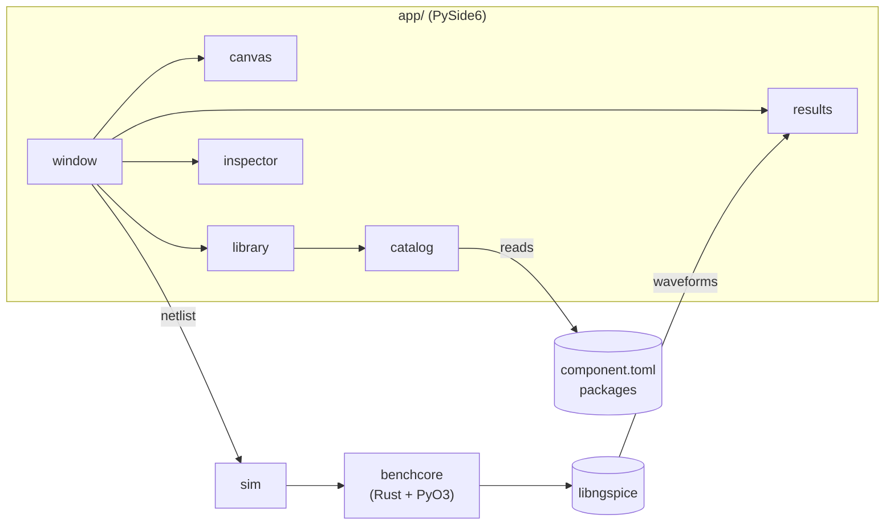

<div align="center">

# Bench

**A native circuit workbench: draw a schematic, run it through real ngspice, scrub the result.**

[](https://github.com/Nexusdeveloper902/Bench/actions/workflows/ci.yml)
[](LICENSE)


[Quick start](#quick-start) · [Features](#features) · [Architecture](#architecture) · [Adding components](#adding-components) · [Docs](#documentation)

</div>

---

## Features

- **Schematic editor.** Drag parts from a searchable library, wire them, move, rotate, undo and redo. Zoom 25–400 %, pan with middle-drag or <kbd>Space</kbd>+drag.
- **Real simulation.** Circuits run through [ngspice](https://ngspice.sourceforge.io/) 47 via `benchcore`, not a toy solver.
- **Live results.** A transient plot with a cursor readout, a time slider and Play. The LED glows by its core current as you scrub.
- **Honest about what it can't do.** Each part carries a readiness badge. *Interface only* parts (ESP32, Arduino Uno, SSD1306, DHT22 …) can be placed and wired but are excluded from the run with a clear message, never silently faked.
- **Data-driven component catalog.** A part is one `component.toml`. Drop it in a folder and it appears in the library, no code change.
- **Stale-result handling.** Edit after a run and the badge flips to *Out of date* until you re-run.

> [!NOTE]
> Bench is under active development. The `milestone/component-ecosystem` work added the catalog, seed packages and the workspace UI; see the [milestone report](docs/milestone/REPORT.md).

## Quick start

### Prerequisites

| Requirement | Why |
|---|---|
| Python 3 with `pip` | the GUI and the `benchcore` wrapper |
| Rust toolchain + [`maturin`](https://www.maturin.rs/) | builds the engine wheel |
| ngspice 47 with `libngspice.so` | the simulation backend |

> [!IMPORTANT]
> `benchcore` loads `libngspice.so` from a fixed path and the tests rely on ngspice 47 behaviour. Distro packages are often older. [CI builds 47 from source](.github/workflows/ci.yml) (with a checksum check) if you need a recipe.

### Build and run

```bash
# 1. Build and install the engine wheel
cd benchcore
maturin build
pip install --user --force-reinstall target/wheels/benchcore-*.whl
cd ..

# 2. Launch the app
python3 -m app
```

Then try **File ▸ Load blinking LED example**, press **Run**, and drag the time slider.

> [!TIP]
> After changing any Rust under `benchcore/`, rebuild and reinstall the wheel before running the app tests.

## Testing

```bash
# App (headless Qt)
QT_QPA_PLATFORM=offscreen python3 -m pytest -q app/tests

# Engine
(cd benchcore && cargo test && python3 -m pytest -q tests/python)

# Validate the component catalog
python3 -m app.catalog
```

<details>
<summary><b>What the suites cover</b></summary>

- **App:** 434 tests, including the end-to-end LED workflow (I(D1) = 9.1772 mA through the real engine).
- **Engine:** 26 Rust tests against real ngspice, plus a Python smoke suite that imports the installed wheel.
- **Strategy:** [`docs/testing-strategy.md`](docs/testing-strategy.md).

</details>

## Architecture



| Path | What lives there |
|---|---|
| [`app/`](app) | PySide6 editor: canvas, library, inspector, results, theme |
| [`app/library/`](app/library) | Built-in component packages, grouped by category |
| [`benchcore/`](benchcore) | Rust kernel + electrical domain over libngspice, exposed to Python with PyO3 |
| [`docs/`](docs) | Frontend design, persistence, testing, milestone and review reports |
| [`experiments/`](experiments) | Throwaway spikes, reference only |

## Adding components

A component is a directory with a `component.toml` and optional SVG assets:

```text
app/library/electrical/d_1n4148/
├── component.toml   # definition (required)
├── symbol.svg       # schematic symbol (optional, generic body if absent)
└── icon.svg         # library icon (optional)
```

Parts backed by a `.subckt` carry it inline or in files, with shared model files in `app/library/_models/`
(see [`docs/adding-components.md`](docs/adding-components.md)). Set `SIM_COMPONENT_PATH` to extra directories to load your own packages, then validate:

```bash
python3 -m app.catalog ~/my-parts
```

<details>
<summary><b>Built-in library (20 parts)</b></summary>

| Category | Parts |
|---|---|
| Electrical | resistor, capacitor, inductor, diode, 1N4148, LED, 2N2222 (NPN transistor), switch, voltage source, current source, ground, op-amp, dual op-amp |
| Power | battery |
| Microcontrollers | ESP32 DevKitC, Arduino Uno R3 |
| Sensors | DHT22, NTC thermistor |
| Displays | SSD1306 (I²C) |
| Audio | piezo buzzer |

</details>

Full guide with worked examples: [`docs/adding-components.md`](docs/adding-components.md).

## Documentation

| Topic | Where |
|---|---|
| Using the editor | [`docs/frontend.md`](docs/frontend.md) |
| Frontend architecture and components | [`docs/frontend-architecture.md`](docs/frontend-architecture.md), [`docs/frontend-components.md`](docs/frontend-components.md) |
| File format | [`docs/persistence.md`](docs/persistence.md) |
| Engine | [`benchcore/docs/`](benchcore/docs) (architecture, API, electrical, testing) |
| Milestone report and reviews | [`docs/milestone/REPORT.md`](docs/milestone/REPORT.md), [`docs/review/`](docs/review) |

## Experiments

Each spike lives in its own folder under [`experiments/`](experiments) with its own `REPORT*.md` or `REPRO.md`.

| Spike | Question |
|---|---|
| `coupling-proto/` | MCU + libngspice coupling validation |
| `exp-bexpr/` | Native ngspice behavioral expressions vs a thin validated layer |
| `exp-native/` | Native resume vs reconstructed continuation |
| `exp-numerical/` | Numerical robustness and convergence |
| `exp-safety/` | Simulation safety boundary |
| `exp-window/` | Continuation-aware event windowing |

## License

[MIT](LICENSE)
